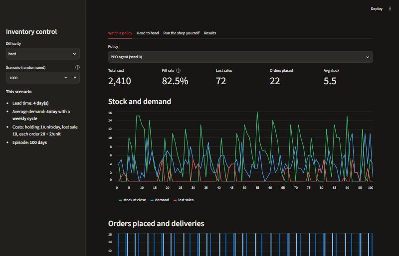

# inventory-rl-env

A small, self-contained reinforcement-learning project: a [Gymnasium](https://gymnasium.farama.org/)
environment for **single-product inventory control** with lost sales and an order lead time, three
difficulty configs, a random baseline, the classic operations-research **(s, S)** policy (grid-searched
per config) and a **PPO** agent from stable-baselines3, all compared over held-out seeds with
confidence intervals, plus an interactive **dashboard** where you can watch each policy, pit them
against each other on identical days, or try running the shop yourself.



**In one sentence:** each day a shopkeeper decides how much stock to order; order too little and
customers walk away, order too much and the shelves cost money; deliveries take several days. Can a
reinforcement-learning agent learn a better ordering rule than the textbook one?

## The MDP

Each step is one day. The agent decides how many units to order.

| | |
|---|---|
| **Action** | `Discrete(max_order + 1)`: order quantity `q ∈ {0, …, 20}` |
| **Observation** | `Box([0, 1]^(L+2))`: on-hand stock / 50 (saturating at 1), each of the `L` outstanding orders / max_order, day of week / 6 |
| **Dynamics** | Pay for the order; the order placed `L` days ago arrives (with `L = 0` it arrives at once); demand `D ~ Poisson(μ_d)` is drawn; `sales = min(stock, D)`; unmet demand is **lost** |
| **Demand** | `μ_d = μ · (1 + a · sin(2π · d / 7))` with `μ = 4` and weekly amplitude `a` (0 = stationary) |
| **Reward** | `−(h · stock_end + p · lost + K · [q > 0] + c · q)` with `h = 1`, `p = 10`, `c = 2`, `K` per config |
| **Episode** | 100 days, then `truncated = True` (a time limit, never `terminated`). Starting stock is random in `[0, 2μ(L+1)]`, starting weekday random; both come from the seeded RNG |

| Config | Lead time `L` | Seasonality `a` | Fixed cost `K` |
|---|---|---|---|
| easy | 0 | 0 | 5 |
| medium | 2 | 0 | 5 |
| hard | 4 | 0.5 | 20 |

```python
import gymnasium as gym
import inventory_rl  # registers the env

env = gym.make("InventoryControl-v0", config="hard")          # or "easy" / "medium"
env = gym.make("InventoryControl-v0", config="medium", lead_time=3, fixed_cost=10)  # override any field
```

## Usage

Install (developed and tested on Python 3.14; any 3.10+ should work):

```bash
pip install -e ".[test,app]"
```

Open the dashboard (uses the committed models, no training needed):

```bash
streamlit run app.py
```

Train PPO: 3 configs × 3 seeds × 150k steps. On a CPU-only laptop this took about 12 minutes with
three runs in parallel:

```bash
python train.py --jobs 3
```

Evaluate random vs (s, S) vs PPO, and write `results/results.md` and `results/learning_curves.png`:

```bash
python evaluate.py
```

The trained models (`results/models/`) and the tuned (s, S) parameters are committed, so
`evaluate.py` and the dashboard run without retraining. Tests: `pytest`.

## The dashboard

| Tab | What it does |
|---|---|
| **Watch a policy** | Pick a difficulty, a scenario (seed) and a policy; see stock, demand, lost sales, orders and deliveries day by day, the fill rate (share of customers served), and where the money went |
| **Head to head** | Runs every policy on exactly the same customers and ranks them, with a cumulative-cost race chart |
| **Run the shop yourself** | You choose each day's order with a slider; at day 100 your cost is ranked against PPO and (s, S) on the same days |
| **Results** | The evaluation table and learning curves below |

The first page load takes about 30 seconds while PyTorch and the trained agents load; after that it
is instant.

## Results

Mean episode return over **30 held-out seeds** (seeds 1000–1029; the (s, S) grid search used
seeds 100–119), ± the half-width of a normal-approximation 95% confidence interval. Returns are minus
the total cost over 100 days, so higher is better. PPO was trained **three times per config** (seeds
0, 1, 2); the PPO column averages the three agents. All policies see the same demand on a given seed,
so the last column is a **paired** difference.

| Config | Random | (s, S) tuned | PPO (3 seeds) | PPO per training seed | PPO − (s, S), paired |
|---|---|---|---|---|---|
| easy | −34280.6 ± 1231.3 | −1541.5 ± 21.8 (s=3, S=9) | −1557.4 ± 21.2 | −1568, −1559, −1545 | −15.9 ± 12.2 |
| medium | −33242.5 ± 1202.6 | −1741.0 ± 28.3 (s=12, S=18) | −1737.6 ± 28.6 | −1749, −1730, −1733 | +3.4 ± 14.7 |
| hard | −33870.2 ± 1176.1 | −2442.4 ± 51.5 (s=17, S=29) | −2360.9 ± 44.1 | −2346, −2337, −2399 | **+81.5 ± 26.4** |


(The plot is zoomed in: every run starts near −34,000, as the untrained agent over-orders and stock
piles up, and that part is cut off so the finish is readable.)

**Does PPO beat (s, S)?** Honestly: only on *hard*, and modestly.

- **easy:** PPO is about 1% *worse* than the tuned (s, S) rule, and the interval just excludes zero.
  With no lead time and steady demand, (s, S) is essentially the right answer, so there is nothing to
  gain and a little to lose.
- **medium:** a tie (the interval comfortably contains zero).
- **hard:** PPO is better by about 82 cost units per 100 days (≈ 3%), and all three training seeds
  beat (s, S). The likeliest reason is the weekly demand cycle: one fixed (s, S) pair cannot react to
  the day of the week, while PPO sees it. That is as much a weakness of the baseline as a strength of
  PPO (see *Next steps*).
- The three seeds agree closely (a spread of 20–60 cost units), so these conclusions are not one
  lucky run. An earlier single-seed run with twice the training (300k steps) gave a larger gap on hard
  (+127), so more training probably helps a little.
- **Random** is catastrophically bad (≈ 20× the cost): it orders 10 units a day on average against
  demand of 4, and the surplus sits on the shelf accruing holding cost.

## Design choices

- **Lost sales rather than backorders.** Backorder models give (s, S) a clean optimality story;
  lost sales with a positive lead time does not have a simple optimal policy, which makes it a more
  interesting test for RL.
- **Normalised, bounded observations.** Everything is scaled into `[0, 1]`, so PPO needs no
  observation normalisation and the env passes `check_env` with a tight `Box`.
- **Rewards in raw cost units.** The environment reports true costs (daily values in the tens), and
  `train.py` rescales them with `VecNormalize(norm_reward=True)` for learning only; evaluation always
  uses the raw environment, so all policies are scored identically.
- **(s, S) on inventory position.** The baseline compares on-hand stock *plus* the pipeline against `s`,
  which is the standard form when there is a lead time. It is tuned by exhaustive grid search
  (`0 ≤ s ≤ 30`, `s < S ≤ 45`) on separate tuning seeds.
- **No silent overflow.** Stock is uncapped, so every unit paid for is either sold or held (and
  charged for). Only the *observation* saturates at 50 units, which no sensible policy approaches.
- **Fixed horizon as truncation.** Episodes end on a time limit, so PPO bootstraps through the last
  step rather than treating day 100 as the end of the world.
- **Reproducibility.** All randomness comes from the env's seeded `np_random`; the policies never
  touch it, which is what makes the paired comparison valid.

## Tests

`pytest` (13 tests, about a second):

- `check_env` passes on all three configs;
- identical seeds and actions give identical trajectories, and different seeds differ;
- cost accounting on a hand-computed three-day episode (scripted demand, lost sales, an arrival);
- holding cost, and that excess stock is kept rather than discarded;
- an order arrives after exactly `L` steps, for `L ∈ {0, 1, 2, 4}`;
- reward sanity: "never order" and "order the maximum every day" both cost at least 40% more than an
  untuned (s, S) policy.

## Limitations

- One product, one location, one supplier, no perishability; demand is Poisson with a known form,
  and the agent is trained and tested on the same demand pattern.
- A modest training budget (150k steps per run, three seeds per config) and no hyperparameter search.
- The 95% intervals use a normal approximation with 30 episodes.
- The (s, S) baseline ignores the weekday, which flatters PPO on the seasonal config.

## Next steps

These are the directions the research literature points to, roughly in the order I would take them.

1. **A fairer opponent for the seasonal case.** Give (s, S) one pair of numbers per weekday, and add a
   *capped base-stock* policy: "order up to a target, but never more than a cap per day". Xin (2021)
   shows this simple rule performs very well on exactly this lost-sales-with-lead-time problem, and it
   is now a standard baseline. If PPO still wins on *hard* after that, the result means more.
2. **Measure the gap to the true optimum.** The easy and medium configs are small enough to solve
   exactly by dynamic programming (value iteration over stock and pipeline). That turns "PPO matches
   (s, S)" into "PPO is within x% of the best possible policy", a much stronger statement.
3. **Robustness.** Train at one demand level and test on busier or quieter weeks, or make the lead
   time random. Uncertain supplier lead times are one of the features of Amazon's real-world deep RL
   inventory work (Madeka et al., 2022), and they are where fixed rules tend to break.
4. **Problems where the textbook rules run out.** Two suppliers (one fast and expensive, one slow and
   cheap), or several products sharing a budget. Gijsbrechts et al. (2022) found deep RL matched the
   best specialised heuristics on lost-sales, dual-sourcing and multi-echelon problems; the case for
   RL is strongest where no good heuristic exists.
5. **Training hygiene.** More seeds, longer runs and a small hyperparameter sweep, reported with the
   same paired confidence intervals.

**References**

- J. Gijsbrechts, R. N. Boute, J. A. Van Mieghem, D. J. Zhang. [Can Deep Reinforcement Learning
  Improve Inventory Management? Performance on Lost Sales, Dual-Sourcing, and Multi-Echelon
  Problems](https://econpapers.repec.org/RePEc:inm:ormsom:v:24:y:2022:i:3:p:1349-1368).
  *Manufacturing & Service Operations Management* 24(3), 2022.
- L. Xin. [Understanding the Performance of Capped Base-Stock Policies in Lost-Sales Inventory
  Models](https://ideas.repec.org/a/inm/oropre/v69y2021i1p61-70.html). *Operations Research* 69(1), 2021.
- D. Madeka et al. [Deep Inventory Management](https://arxiv.org/abs/2210.03137). arXiv:2210.03137, 2022.

## Layout

```
inventory_rl/env.py       environment and the three configs
inventory_rl/policies.py  random, constant, (s, S) and PPO policies, episode runner, grid search
train.py                  PPO training (writes results/models/ and results/curves/)
evaluate.py               comparison table, results.json and plot
app.py                    Streamlit dashboard
tests/test_env.py         tests
```

## Licence

MIT.
