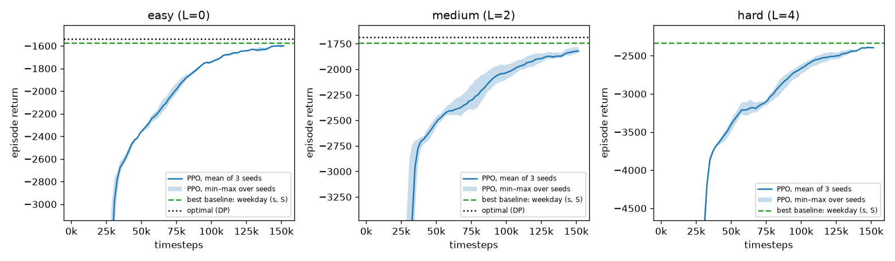

# inventory-rl-env

A small, self-contained reinforcement-learning project: a [Gymnasium](https://gymnasium.farama.org/)
environment for **single-product inventory control** with lost sales and an order lead time, three
difficulty configs, three tuned operations-research baselines, the **exact optimal policy** (by dynamic
programming, where the state space allows it) and a **PPO** agent from stable-baselines3, all compared
over held-out seeds with paired confidence intervals, plus an interactive **dashboard** where you can watch each policy, pit them
against each other on identical days, or try running the shop yourself.


**In one sentence:** each day a shopkeeper decides how much stock to order; order too little and
customers walk away, order too much and the shelves cost money; deliveries take several days. Can a
reinforcement-learning agent learn a better ordering rule than the textbook one? (Short answer: here,
it learns one about as good, but not better, and both sit a few per cent above the true optimum.)

## The MDP

Each step is one day. The agent decides how many units to order.

| | |
|---|---|
| **Action** | `Discrete(max_order + 1)`: order quantity `q ∈ {0, …, 20}` |
| **Observation** | `Box([0, 1]^(L+3))`: on-hand stock / 50 (saturating at 1), each of the `L` outstanding orders / max_order, day of week / 6, days left / 100 |
| **Dynamics** | Pay for the order; the order placed `L` days ago arrives (with `L = 0` it arrives at once); demand `D ~ Poisson(μ_d)` is drawn; `sales = min(stock, D)`; unmet demand is **lost** |
| **Demand** | `μ_d = μ · (1 + a · sin(2π · d / 7))` with `μ = 4` and weekly amplitude `a` (0 = stationary) |
| **Reward** | `−(h · stock_end + p · lost + K · [q > 0] + c · q)` with `h = 1`, `p = 10`, `c = 2`, `K` per config |
| **Episode** | 100 days, then `truncated = True` (a time limit, never `terminated`). Starting stock is random in `[0, 2μ(L+1)]`, starting weekday random; both come from the seeded RNG |

| Config | Lead time `L` | Seasonality `a` | Fixed cost `K` |
|---|---|---|---|
| easy | 0 | 0 | 5 |
| medium | 2 | 0 | 5 |
| hard | 4 | 0.5 | 20 |

```python
import gymnasium as gym
import inventory_rl  # registers the env

env = gym.make("InventoryControl-v0", config="hard")          # or "easy" / "medium"
env = gym.make("InventoryControl-v0", config="medium", lead_time=3, fixed_cost=10)  # override any field
```

## Usage

Install (developed and tested on Python 3.14; any 3.10+ should work):

```bash
pip install -e ".[test,app]"
```

Open the dashboard (uses the committed models, no training needed):

```bash
streamlit run app.py
```

Train PPO: 3 configs × 3 seeds × 150k steps. On a CPU-only laptop this took about 12 minutes with
three runs in parallel:

```bash
python train.py --jobs 3
```

Evaluate everything (about 6 minutes, mostly the medium-config dynamic programme and PPO rollouts) and
write `results/results.md`, `results/results.json` and `results/learning_curves.png`:

```bash
python evaluate.py
```

The trained models (`results/models/`) and the tuned baseline parameters
(`results/baseline_params.json`) are committed, so `evaluate.py` and the dashboard run without
retraining or retuning. (Tuning all baselines from scratch took about 30 minutes on the same laptop,
mostly the weekday (s, S) search, while training was also running.) Tests: `pytest`.

## The dashboard

| Tab | What it does |
|---|---|
| **Watch a policy** | Pick a difficulty, a scenario (seed) and a policy; see stock, demand, lost sales, orders and deliveries day by day, the fill rate (share of customers served), and where the money went |
| **Head to head** | Runs every policy on exactly the same customers and ranks them, with a cumulative-cost race chart |
| **Run the shop yourself** | You choose each day's order with a slider; at day 100 your cost is ranked against PPO, the baselines and (on easy and medium) the optimal policy, on the same days |
| **Results** | The evaluation table and learning curves below |

The first page load takes about 30 seconds while PyTorch and the trained agents load; after that it
is instant.

## Results

**Policies compared** (all baselines tuned on seeds 100–119; everything scored on held-out seeds
1000–1029):

- **(s, S):** when stock plus orders on the way falls to `s` or below, order up to `S`. Grid search
  over `0 ≤ s ≤ 30`, `s < S ≤ 45`.
- **weekday (s, S):** the same, with a separate `(s, S)` pair for each day of the week, tuned by
  coordinate descent from the plain (s, S) (one weekday at a time, up to three sweeps).
- **capped base-stock:** order up to a target, but never more than a cap per day (Xin, 2021). Grid
  search over the target (0–45) and the cap (1–20).
- **Optimal (DP):** the exact optimal policy by finite-horizon dynamic programming over (stock,
  pipeline, weekday, day), with demand truncated at 30 units. Tractable for easy (0.1 s) and medium
  (30 s, about 190k states per day), not for hard (lead time 4 gives about 83 million states per day).
- **PPO:** trained three times per config (seeds 0, 1, 2); the PPO column averages the three agents
  on each evaluation seed.

Mean episode return (minus total cost over 100 days, so higher is better) ± the half-width of a
normal-approximation 95% confidence interval. ★ marks the strongest baseline, **chosen on the tuning
seeds** rather than the evaluation seeds. The last column is a paired difference: every policy faces
the same demand on a given seed.

| Config | Optimal (DP) | (s, S) | weekday (s, S) | capped base-stock | PPO (3 seeds) | PPO per seed | PPO − strongest baseline |
|---|---|---|---|---|---|---|---|
| easy | −1537.7 ± 23.2 | −1541.5 ± 21.8 | −1572.1 ± 24.5 ★ | −1669.9 ± 24.2 | −1572.4 ± 21.0 | −1562, −1573, −1582 | −0.3 ± 17.7 |
| medium | −1683.5 ± 25.2 | −1741.0 ± 28.3 | −1740.3 ± 27.0 ★ | −1814.9 ± 24.6 | −1743.4 ± 29.7 | −1764, −1726, −1740 | −3.1 ± 18.8 |
| hard | not tractable | −2442.4 ± 51.5 | −2329.9 ± 41.2 ★ | −3463.8 ± 42.1 | −2342.8 ± 44.4 | −2337, −2347, −2344 | −12.9 ± 23.0 |

Extra cost compared with the optimal policy (paired on the same seeds, ± 95% CI; lower is better):

| Config | (s, S) | weekday (s, S) | capped base-stock | PPO (3 seeds) |
|---|---|---|---|---|
| easy | 0.2% ± 0.2 | 2.2% ± 1.1 | 8.6% ± 1.0 | 2.3% ± 1.0 |
| medium | 3.4% ± 1.0 | 3.4% ± 1.1 | 7.8% ± 1.0 | 3.6% ± 1.1 |

A random policy, for scale, scores about −34,000 on every config (roughly 20 times the cost): it
orders 10 units a day on average against demand of 4, and the surplus piles up on the shelf.



(The curves show training episodes with PPO's exploration switched on, so they sit a little below
the evaluation numbers. They are zoomed in: every run starts near −34,000.)

**What this says**

- **PPO does not beat the strongest baseline on any config.** Every paired difference contains zero.
  An earlier version of this project reported PPO beating (s, S) by about 3% on *hard*; that gap was
  entirely due to the baseline ignoring the weekday. Once (s, S) gets one pair per weekday, the two
  are level.
- **PPO is close to optimal, but not there.** It costs 2.3% more than the optimum on easy and 3.6%
  more on medium. The learning curves are still rising at 150k steps, so a larger budget would
  probably narrow this.
- **The optimum leaves room on medium.** With a two-day lead time and lost sales, the best (s, S)
  is 3.4% above the optimum, which is consistent with the literature: no simple rule is optimal once
  there is a lead time. Neither PPO nor any heuristic here finds that last 3%.
- **On easy, plain (s, S) is essentially optimal** (0.2% gap), as theory predicts with no lead time
  and steady demand. The weekday version, which the tuning seeds preferred, is 2.2% worse on held-out
  seeds: with 14 parameters and 20 tuning episodes it overfits demand noise. Choosing the strongest
  baseline on the tuning seeds is the honest protocol, but it means the ★ baseline on easy and medium
  is slightly weaker than plain (s, S).
- **Capped base-stock does poorly here** (8–9% above optimal on easy and medium, far worse on hard).
  Xin's analysis has no fixed ordering cost; with a fee of 5 to 20 per order, a rule that orders
  almost every day pays that fee constantly, while (s, S) batches orders.
- The three PPO seeds agree closely (a spread of 10–40 cost units).

## Design choices

- **Lost sales rather than backorders.** Backorder models give (s, S) a clean optimality story;
  lost sales with a positive lead time does not have a simple optimal policy, which makes it a more
  interesting test for RL.
- **Normalised, bounded observations.** Everything is scaled into `[0, 1]`, so PPO needs no
  observation normalisation and the env passes `check_env` with a tight `Box`.
- **Rewards in raw cost units.** The environment reports true costs (daily values in the tens), and
  `train.py` rescales them with `VecNormalize(norm_reward=True)` for learning only; evaluation always
  uses the raw environment, so all policies are scored identically.
- **(s, S) on inventory position.** The baseline compares on-hand stock *plus* the pipeline against `s`,
  which is the standard form when there is a lead time. It is tuned by exhaustive grid search
  (`0 ≤ s ≤ 30`, `s < S ≤ 45`) on separate tuning seeds.
- **No silent overflow.** Stock is uncapped, so every unit paid for is either sold or held (and
  charged for). Only the *observation* saturates at 50 units, which no sensible policy approaches.
- **Days left in the observation.** Episodes always last 100 days, and the right action near the end
  differs (there is no point restocking on day 99). Without the day count the problem is not Markov in
  the observation; with it, the agent can in principle learn end-of-horizon behaviour, as the DP does.
- **Fixed horizon as truncation.** Episodes end on a time limit, so `truncated = True`, never
  `terminated`.
- **An exact optimum where possible.** Comparing PPO only with heuristics says nothing about how much
  is left on the table; the dynamic programme gives the absolute yardstick for easy and medium.
- **Reproducibility.** All randomness comes from the env's seeded `np_random`; the policies never
  touch it, which is what makes the paired comparison valid.

## Tests

`pytest` (15 tests, about 10 seconds):

- `check_env` passes on all three configs;
- the observation carries days left, from 1 at reset to 0 at truncation;
- identical seeds and actions give identical trajectories, and different seeds differ;
- cost accounting on a hand-computed three-day episode (scripted demand, lost sales, an arrival);
- holding cost, and that excess stock is kept rather than discarded;
- an order arrives after exactly `L` steps, for `L ∈ {0, 1, 2, 4}`;
- reward sanity: "never order" and "order the maximum every day" both cost at least 40% more than an
  untuned (s, S) policy;
- the DP on a small seasonal config with a lead time: its exact expected value agrees with 2,000
  simulated episodes, and no (s, S) policy tried beats it.

## Limitations

- One product, one location, one supplier, no perishability; demand is Poisson with a known form,
  and the agent is trained and tested on the same demand pattern.
- A modest training budget (150k steps per run, three seeds per config) and no hyperparameter search;
  the learning curves have not flattened.
- No exact optimum for *hard*, so there the only yardstick is the weekday (s, S).
- The DP truncates stock at 60 and demand at 30; both are far beyond anything that matters here, and
  the exact values match simulation.
- The 95% intervals use a normal approximation with 30 episodes.

## Next steps

These are the directions the research literature points to, roughly in the order I would take them.

*Done in this version:* a weekday (s, S) and a capped base-stock baseline (Xin, 2021), and the exact
optimum by dynamic programming for easy and medium. What remains:

1. **Close the last 3% on medium.** The DP shows it exists. Longer training, a small hyperparameter
   sweep, or starting PPO from the DP policy (imitation, then fine-tuning) are the obvious attempts.
2. **A yardstick for hard.** An approximate optimum (for example, a DP over a coarser state space, or
   a lower bound) would say how far the weekday (s, S) and PPO are from the best possible on the
   seasonal config.
3. **Robustness.** Train at one demand level and test on busier or quieter weeks, or make the lead
   time random. Uncertain supplier lead times are one of the features of Amazon's real-world deep RL
   inventory work (Madeka et al., 2022), and they are where fixed rules tend to break.
4. **Problems where the textbook rules run out.** Two suppliers (one fast and expensive, one slow and
   cheap), or several products sharing a budget. Gijsbrechts et al. (2022) found deep RL matched the
   best specialised heuristics on lost-sales, dual-sourcing and multi-echelon problems; the case for
   RL is strongest where no good heuristic exists.
5. **Fixed ordering costs in capped base-stock.** Combining the cap with a reorder point (order only
   when well below target) would make it competitive when every order carries a fee.

**References**

- J. Gijsbrechts, R. N. Boute, J. A. Van Mieghem, D. J. Zhang. [Can Deep Reinforcement Learning
  Improve Inventory Management? Performance on Lost Sales, Dual-Sourcing, and Multi-Echelon
  Problems](https://econpapers.repec.org/RePEc:inm:ormsom:v:24:y:2022:i:3:p:1349-1368).
  *Manufacturing & Service Operations Management* 24(3), 2022.
- L. Xin. [Understanding the Performance of Capped Base-Stock Policies in Lost-Sales Inventory
  Models](https://ideas.repec.org/a/inm/oropre/v69y2021i1p61-70.html). *Operations Research* 69(1), 2021.
- D. Madeka et al. [Deep Inventory Management](https://arxiv.org/abs/2210.03137). arXiv:2210.03137, 2022.

## Layout

```
inventory_rl/env.py       environment and the three configs
inventory_rl/policies.py  baselines, PPO loader, episode runner and baseline tuning
inventory_rl/dp.py        exact finite-horizon dynamic programming (easy and medium)
train.py                  PPO training (writes results/models/ and results/curves/)
evaluate.py               comparison table, results.json and plot
app.py                    Streamlit dashboard
tests/test_env.py         tests
```

## Licence

MIT.
